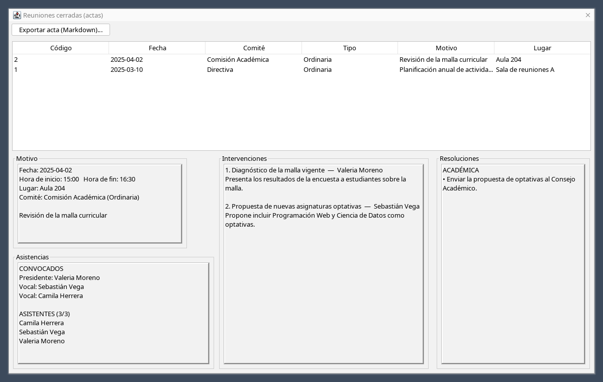
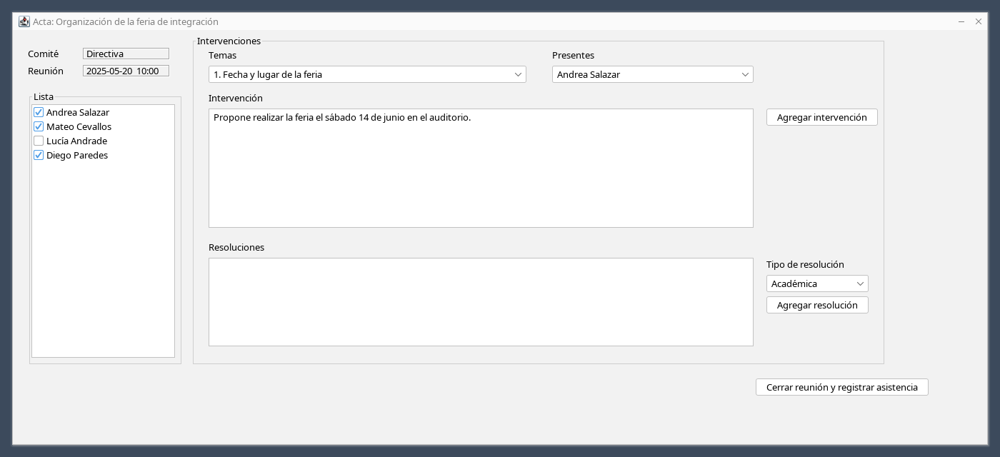
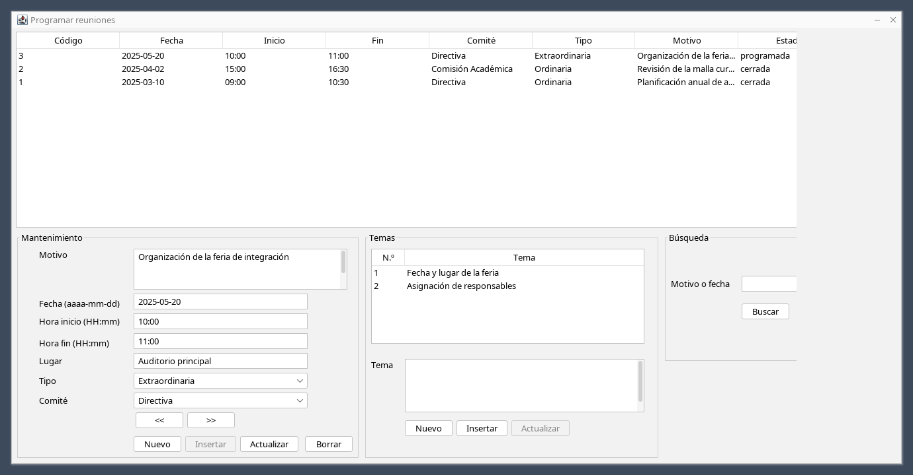
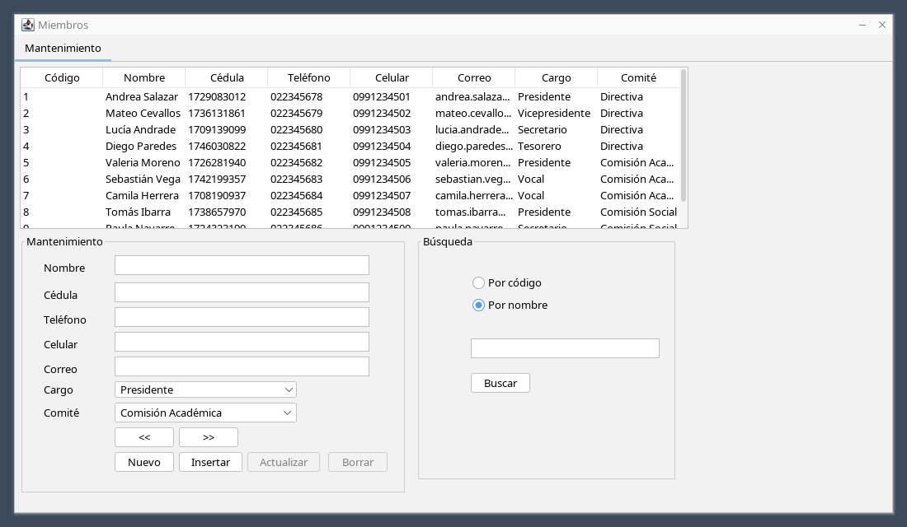
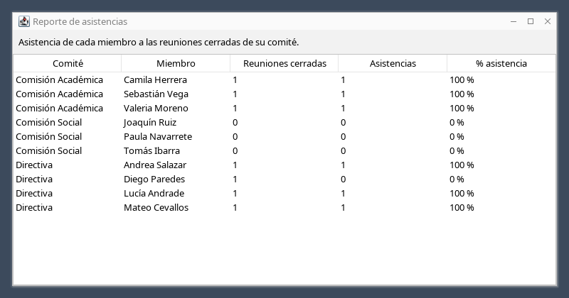
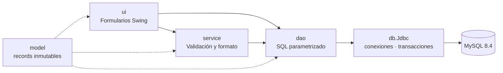

# Sistema de Actas


Aplicación de escritorio para gestionar los **comités de una organización**, sus **miembros**, la
**programación de reuniones** y el **registro de actas**: asistencia, intervenciones por tema y
resoluciones, con reportes de asistencia y exportación del acta a Markdown.

> **Proyecto legado modernizado.** El sistema se escribió originalmente en 2009 con Java 5,
> NetBeans 6 y MySQL 5 (MyISAM). En 2026 se migró a **Java 21 LTS** con Maven, se reescribió la
> capa de datos y la lógica de negocio, y se añadieron pruebas automatizadas, Docker y CI.
> El análisis completo está en [docs/MIGRACION.md](docs/MIGRACION.md).



---

## Funcionalidades

| Módulo | Qué hace |
|---|---|
| **Inicio de sesión** | Autenticación contra la base de datos con contraseñas en hash PBKDF2; se cierra tras 3 intentos fallidos. |
| **Miembros** | Alta, edición, baja, navegación y búsqueda (por código o nombre). Validación de cédula ecuatoriana (módulo 10), correo y teléfonos. |
| **Reuniones** | Programación de reuniones por comité y tipo (ordinaria/extraordinaria) con su orden del día (temas numerados). |
| **Registro del acta** | Marcar asistentes, registrar intervenciones por tema y resoluciones (académicas/administrativas), y cerrar la reunión en una transacción. |
| **Actas cerradas** | Consulta del acta completa y **exportación a Markdown**. |
| **Reporte de asistencias** | Porcentaje de asistencia de cada miembro a las reuniones de su comité. |
| **Usuarios** | Administración de usuarios y roles (solo administradores). |

<table>
  <tr>
    <td></td>
    <td></td>
  </tr>
  <tr>
    <td></td>
    <td></td>
  </tr>
</table>

## Stack

- **Java 21 LTS**: records, pattern matching con `instanceof`, text blocks, `List.getFirst()`, `Math.clamp`.
- **Swing** con el look & feel moderno **FlatLaf**.
- **JDBC** puro sobre una pequeña capa propia (`Jdbc`) con `PreparedStatement`, transacciones y traducción de errores.
- **MySQL 8.4** (InnoDB, utf8mb4, claves foráneas) en **Docker Compose**.
- **JUnit 6 + AssertJ + H2** (modo MySQL) para las pruebas, usando los mismos scripts SQL que Docker.
- **Maven** (con Maven Wrapper) y **GitHub Actions** para integración continua.

## Inicio rápido

**Requisitos:** JDK 21 (no basta el JRE) y Docker.

```bash
# 1. Base de datos con esquema y datos de demostración (ficticios)
docker compose up -d --wait

# 2. Compilar, ejecutar las pruebas y generar el JAR ejecutable
./mvnw verify          # en Windows: mvnw.cmd verify

# 3. Ejecutar
java -jar target/sistema-actas.jar
```

Usuario de demostración: **`admin`** / **`admin123`**

### Configuración

La conexión se configura sin recompilar. Por defecto apunta al contenedor de Docker
(`jdbc:mysql://localhost:3306/actas`, usuario `actas`). Se puede sobrescribir con:

1. Un archivo `actas.properties` en el directorio desde el que se ejecuta la aplicación:
   ```properties
   db.url=jdbc:mysql://mi-servidor:3306/actas
   db.user=usuario
   db.password=secreto
   ```
2. Variables de entorno (tienen prioridad): `ACTAS_DB_URL`, `ACTAS_DB_USER`, `ACTAS_DB_PASSWORD`.

Para crear el hash de una contraseña nueva directamente en la base:

```bash
java -cp target/sistema-actas.jar actas.security.PasswordHasher "mi-clave"
```

## Pruebas

```bash
./mvnw test
```

45 pruebas sobre una base H2 en memoria inicializada con [`db/01-schema.sql`](db/01-schema.sql) y
[`db/02-seed.sql`](db/02-seed.sql). Cubren, entre otros casos:

- **Inyección SQL**: nombres como `O'Brien'); DROP TABLE miembros; --` se guardan como datos.
- **Transacciones**: si falla una asistencia al cerrar una reunión, se revierte también el cambio de estado.
- **Integridad referencial**: no se puede borrar un miembro con actas registradas; borrar una reunión elimina su acta en cascada.
- **Seguridad**: hash con sal aleatoria, verificación en tiempo constante, credenciales que no se filtran en logs.
- **Validaciones**: cédula ecuatoriana, horas (incluido el formato heredado `9h00`), fechas y rangos.

## Arquitectura



Las dependencias se inyectan por constructor desde `AppContext` (sin estado global estático).
Detalles, modelo de datos y decisiones de diseño en [docs/ARQUITECTURA.md](docs/ARQUITECTURA.md).

```
├── db/                      Scripts SQL (esquema + datos ficticios), usados por Docker y por los tests
├── docs/                    Arquitectura, análisis de migración y capturas
├── src/main/java/actas/
│   ├── App.java             Punto de entrada
│   ├── AppContext.java      Composición de dependencias
│   ├── config/              Configuración externa de la conexión
│   ├── db/                  Capa JDBC (Jdbc, excepciones)
│   ├── model/               Records del dominio
│   ├── dao/                 Acceso a datos por agregado
│   ├── service/             Reglas de negocio, validación, formato del acta
│   ├── security/            Hash de contraseñas (PBKDF2)
│   └── ui/                  Formularios Swing y componentes reutilizables
└── src/test/java/actas/     Pruebas unitarias y de integración (H2)
```

## De 2009 a 2026: resumen de la modernización

| Aspecto | Original (2009) | Modernizado (2026) |
|---|---|---|
| Java | 1.5, proyecto NetBeans/Ant con rutas `C:\Documents and Settings\...` | 21 LTS, Maven, independiente del IDE |
| SQL | Concatenación de texto → **inyección SQL** en todos los formularios | `PreparedStatement` en el 100 % de las consultas |
| Conexiones | Una nueva por consulta, nunca se cerraban | try-with-resources; transacciones explícitas |
| Errores | `catch (Exception e) {}` vacíos | Excepciones tipadas y mensajes claros al usuario |
| Credenciales BD | `root` sin contraseña, fijo en el código | Archivo de configuración o variables de entorno |
| Contraseñas de usuarios | Texto plano; el login no validaba nada | Hash PBKDF2 + login funcional |
| Base de datos | MyISAM, latin1, sin claves foráneas, horas como texto | InnoDB, utf8mb4, FK, `CHECK`, `UNIQUE`, `TIME` |
| Estado | Variables `static` globales entre formularios | Inyección de dependencias por constructor |
| Módulos | Usuarios y reportes sin implementar | Implementados (incluida exportación a Markdown) |
| Calidad | Sin pruebas | 45 pruebas automatizadas + CI |
| Librerías | JasperReports 2.0.3, MySQL Connector 5.0 (con vulnerabilidades conocidas) | Dependencias actuales y mínimas |

## Próximos pasos

- Pool de conexiones (HikariCP) y operaciones de base de datos fuera del hilo de eventos (`SwingWorker`).
- Migraciones versionadas del esquema con Flyway.
- Reescribir los layouts generados por NetBeans con MigLayout para que sean adaptables.
- Exportar el acta a PDF.
