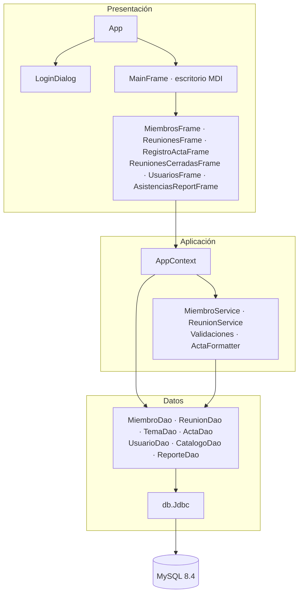
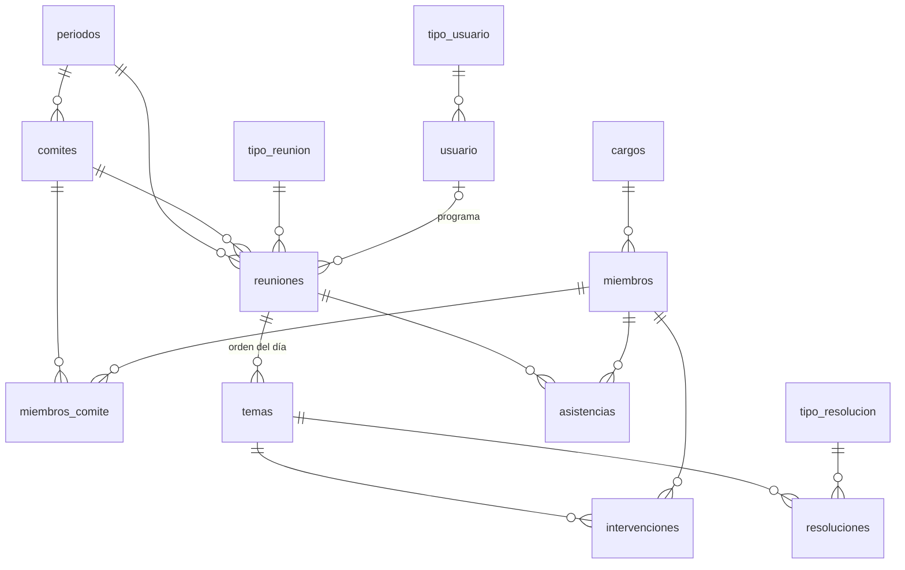
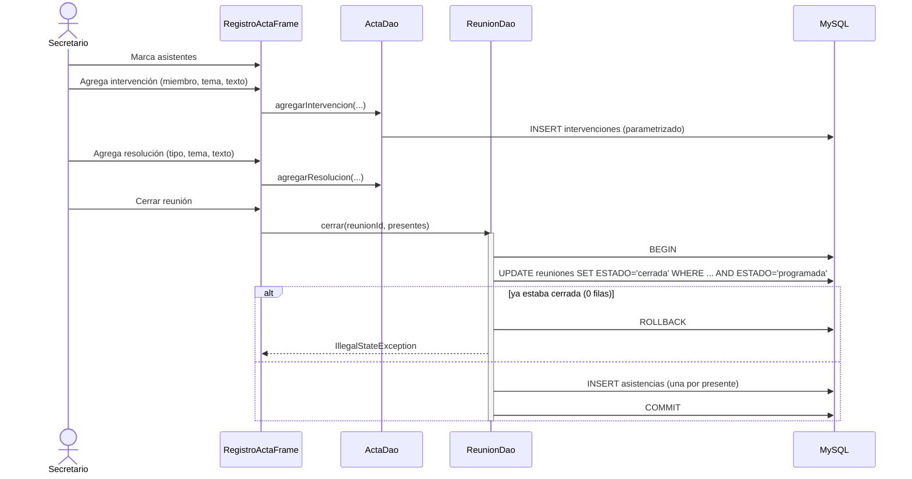

# Arquitectura

## Capas

| Paquete | Responsabilidad | No debe |
|---|---|---|
| `actas.ui` | Mostrar datos, leer el formulario, delegar y mostrar errores (`Ui.run`) | Contener SQL |
| `actas.service` | Validar y convertir la entrada (texto → `LocalDate`/`LocalTime`), formatear el acta | Conocer Swing |
| `actas.dao` | Una clase por agregado; todo el SQL de la aplicación vive aquí | Validar reglas de negocio |
| `actas.db` | Conexiones, parámetros, transacciones y traducción de `SQLException` | Conocer el dominio |
| `actas.model` | `record`s inmutables y el enum `EstadoReunion` | Tener lógica de persistencia |
| `actas.config` | Origen de la configuración (archivo / variables de entorno) | — |
| `actas.security` | Hash y verificación de contraseñas | — |

## Modelo de datos

Reglas que garantiza la base de datos (y no solo la aplicación):

- Una reunión solo puede estar `programada` o `cerrada` (`CHECK`).
- No hay dos temas con el mismo número en una reunión, ni asistencias duplicadas (`UNIQUE`).
- Borrar una reunión elimina en cascada sus temas, intervenciones, resoluciones y asistencias.
- No se puede borrar un miembro que ya figura en un acta (FK sin cascada).

## Flujo principal: registrar y cerrar un acta

La condición `AND ESTADO = 'programada'` hace que el cierre sea idempotente y seguro frente a dos
usuarios cerrando la misma reunión a la vez.

## Decisiones de diseño

**JDBC con una capa propia en lugar de un ORM.** El dominio es pequeño (14 tablas) y las consultas
del acta son *joins* específicos. `Jdbc` (≈150 líneas) aporta lo que faltaba en el original
(parámetros, cierre de recursos, transacciones, errores tipados) sin añadir la complejidad de
JPA/Hibernate a una aplicación de escritorio.

**Inyección de dependencias manual.** `AppContext` construye los DAO y servicios una vez y los
formularios los reciben por constructor. Sin contenedor (Spring) porque no aporta valor a este
tamaño, pero con el mismo beneficio: nada depende de estado estático y todo se puede probar.

**Pruebas con H2 en modo MySQL usando los scripts reales.** `TestDatabase` carga
`db/01-schema.sql` y `db/02-seed.sql`, los mismos que usa Docker, así que el esquema probado es el
que se despliega. Cada prueba usa una base en memoria independiente. CI además valida los scripts
en un MySQL 8.4 real.

**Records para el modelo.** Los objetos del dominio son inmutables; los campos "de presentación"
(nombre del cargo, del comité) vienen del *join* y evitan consultas adicionales por fila, que era
el patrón N+1 del original.

**Swing conservado.** El objetivo era modernizar el sistema, no reescribirlo con otra tecnología.
Se mantuvieron los layouts originales y se sustituyó el aspecto con FlatLaf. La interfaz no
conoce SQL, por lo que reemplazarla (JavaFX, web) solo requeriría reescribir el paquete `ui`.

## Limitaciones conocidas

- Las consultas se ejecutan en el hilo de eventos de Swing; con los volúmenes de una organización
  pequeña no se nota, pero un `SwingWorker` sería lo correcto para bases remotas.
- No hay pool de conexiones (`DriverManager` por operación).
- Un miembro pertenece a un solo comité en la interfaz, aunque el esquema admite varios.
- El esquema se crea con scripts de inicialización; para evolucionarlo convendría Flyway.
